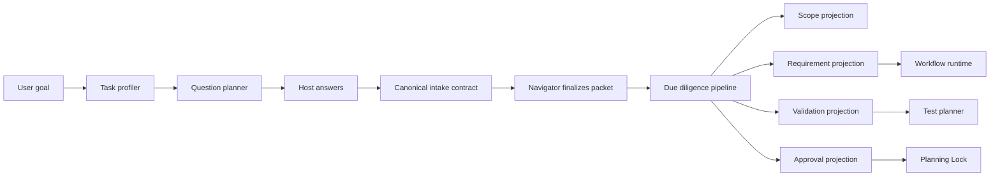

# TailTrail Host Question Flow

Status: draft for review

## Purpose

TailTrail should guide the host through missing task information instead of
requiring the host to repeat the complete TailTrail rulebook or allowing
incomplete information to become an inferred implementation plan.

The desired behavior is:

- no silent inference of implementation ownership or proof;
- no unnecessary questionnaire for simple tasks;
- no hard termination when information is missing;
- resumable clarification between the host, TailTrail, and the user;
- no Planning Lock until the required contract is complete.

A missing answer should create a clarification state, not a misleading scope
or an unexplained failure.

## Flow

```text
User starts TailTrail
        |
        v
Task profiler
        |
        v
Profile-specific question set
        |
        v
Host answers questions
        |
        v
TailTrail due diligence
        |
   +----+----+
   |         |
accepted  clarification
   |         |
Planning   host/user
Lock       follow-up
```

## Task Profiling

The profiler should classify the request before detailed scope resolution.
Relevant dimensions include:

- task type: implementation, documentation, QA, infrastructure, or review;
- existing file versus proposed new file;
- single-file versus multi-file change;
- source, configuration, data, documentation, or test paths;
- behavior and compatibility impact;
- risk level;
- existing proof versus proposed proof;
- edit authority versus read-only analysis.

The profile selects the smallest useful question set. A prose-only document
change should not receive the same questionnaire as a new production feature.

## Profile Questions

### Documentation

Ask only:

- Which document is changing?
- Is the change prose-only?
- What audience or behavior should the document describe?
- Are code and configuration changes excluded?

### Existing Code

Ask:

- Which existing path owns the behavior?
- What behavior changes?
- Which callers or consumers must remain compatible?
- Which existing test proves the behavior?
- What command should run after the edit?
- What behavior must remain unchanged?

### New Feature

Ask:

- Which new files may be created?
- Which path is the proposed implementation owner?
- Which paths are inspection-only?
- Which test path will be created?
- Which public entry point or caller uses the feature?
- What command proves the feature?
- What are the positive and negative acceptance criteria?

### Configuration or Data

Ask:

- Is the path implementation-owned, inspection-only, generated, or proof-only?
- Which consumer owns the behavior?
- What schema or format must remain valid?
- Is write authority explicitly granted?

## Host Input Contract

The host answers should be stored once in a hash-bound contract. Later
requirement, scope, proof, and report artifacts should reference the contract
rather than repeat and reinterpret its fields.

```json
{
  "type": "tailtrail-host-input-contract",
  "profile": "new-feature",
  "paths": [
    {
      "path": "scripts/feature-health-audit.py",
      "role": "proposed-implementation-owner"
    },
    {
      "path": "tests/test_feature_health_audit.py",
      "role": "proposed-proof-path"
    },
    {
      "path": "tailtrail-registry.json",
      "role": "inspection-input"
    }
  ],
  "criteria": {
    "positive": ["The audit emits machine-readable findings."],
    "negative": ["The audit does not modify repository files."]
  },
  "proof": {
    "command": "PYTHONDONTWRITEBYTECODE=1 python3 -m unittest tests.test_feature_health_audit -v",
    "tiers": ["unit"]
  }
}
```

The contract should distinguish existing paths from proposed paths. A new
feature is allowed to name a test that does not exist yet, but completion must
require that the test is created and passes.

## TailTrail Due Diligence

After receiving the host answers, TailTrail independently checks:

- paths exist or are explicitly proposed as new;
- roles do not conflict;
- implementation ownership has evidence;
- proof is relevant to the requirement;
- validation commands are executable;
- test paths are not promoted to implementation owners;
- generated and worktree paths are excluded from product scope;
- positive and negative criteria are covered;
- callers, dependencies, and protected behavior are accounted for.

The result should be one of:

- accepted: create the Planning Lock;
- clarification: ask the host for missing or contradictory information;
- user-decision: ask the user to resolve a product or scope choice;
- revise-profile: change the task profile and ask a smaller or different set of
  questions.

TailTrail must not promote a generic graph match into an implementation owner
when the host contract is incomplete.

## Resumable States

The workflow should represent progress explicitly:

```text
intake
  -> profiling
  -> awaiting-host-answers
  -> due-diligence
  -> awaiting-clarification
  -> awaiting-user-decision
  -> requirements-finalized
  -> internal-due-diligence
  -> internal-clarification-routed-to-navigator
  -> awaiting-approval
  -> approved
  -> activated
```

A missing answer keeps the run resumable. It does not create a Planning Lock and
does not silently infer scope.

Clarification should be bounded:

- no more than five host-question rounds;
- no more than three material questions per round;
- after the limit, ask the user for a decision with the unresolved evidence
  clearly named.

The workflow should not loop indefinitely between the host and TailTrail.

## Responsibility Split

### Host

- provide the user's goal and known context;
- answer profile-specific questions;
- declare path roles when known;
- clarify unknowns when TailTrail asks.

### TailTrail

- select the task profile;
- generate the smallest relevant question set;
- validate host answers;
- perform scope and proof due diligence;
- preserve the hash-bound contract;
- ask follow-up questions when evidence is insufficient;
- prevent bypasses across CLI and MCP entry points.

### User

- resolve genuine product, ownership, or scope decisions that repository
  evidence and host context cannot determine.

## Entry-Point Consistency

The preflight contract should be shared by:

- the top-level CLI;
- the orchestration facade;
- MCP Start tools;
- any direct internal Start entry point.

No entry point should be able to skip profiling or create a Planning Lock from
an incomplete host contract.

## P7 Acceptance Boundary

The P7 incident should become a regression test for this flow:

```text
P7 goal with no declared implementation owner or proof
  -> awaiting-host-answers or awaiting-clarification
  -> no resolved implementation owner
  -> no test_delivery_record.py proof
  -> no Planning Lock
```

A valid P7 packet with an explicit proposed implementation path and proposed
proof path should progress to scope and proof due diligence.

## Navigator as the Host Boundary

Navigator is the only component allowed to communicate with the host about task
meaning, scope, paths, roles, requirements, or clarification. The internal
pipeline may coordinate components, but downstream components must never ask
the host questions directly.

```text
User <-> Host <-> Navigator <-> Internal pipeline <-> TailTrail components
```

The internal pipeline is not a second host conversation layer. It consumes and
validates Navigator's finalized output.

### Navigator responsibilities

Navigator owns:

- task profiling and profile-specific questions;
- host answer collection and clarification routing;
- requirement interpretation and path-role declarations;
- existing versus proposed-new path classification;
- positive and negative acceptance criteria;
- proof intent and validation command collection;
- final requirement and scope packet creation.

Navigator may return to the host when internal due diligence discovers a
contradiction or missing decision, but the request must be routed through
Navigator using the same question and answer IDs.

### Internal component restrictions

Internal components:

- consume only validated Navigator projections;
- may validate, enrich, reject, or emit evidence;
- may not contact the host directly;
- may not invent or rewrite requirements;
- may not reinterpret a path role;
- may not silently ask the host for missing information.

If an internal component cannot continue, it emits a typed clarification event
to the pipeline. Navigator converts that event into a host-facing question,
collects the answer, and emits a revised packet version.

## Requirement Finalization Boundary

All host questions and answers must be completed before Navigator finalizes the
requirement packet. The finalized packet is the handoff from the conversational
layer to the internal execution layer.

```text
intake
  -> profiling
  -> navigator questions
  -> host answers
  -> navigator due diligence
  -> navigator clarification, if needed
  -> finalized requirement packet
  -> internal projections
  -> planning and execution components
```

After finalization:

- downstream components consume only the packet version they were given;
- corrections create a new packet version through Navigator;
- the old packet remains immutable history;
- no component creates a new host question outside Navigator;
- Planning Lock approval applies to the finalized packet version.

The pipeline should expose a clear status such as
`requirements-finalized` before it produces scope, proof, workflow, or approval
projections.

## Internal Clarification Routing

Internal components still need a safe way to report gaps. They should emit a
typed event rather than communicating with the host:

```json
{
  "event": "clarification-required",
  "source_component": "test-planner",
  "packet_id": "packet-42",
  "requirement_id": "req-03",
  "question_kind": "proof-command",
  "reason": "The proposed proof command does not exercise the requirement.",
  "evidence_refs": ["proof-binding-18"]
}
```

Navigator receives the event and either asks the host a bounded question, asks
the user for a product decision, or rejects the internal interpretation with
an explainable reason. The component never receives raw host conversation state
and never bypasses Navigator to obtain an answer.

## Canonical Intake Pipeline

The host-question flow should not make every TailTrail component understand or
reinterpret host answers. A central intake pipeline should own the validated
contract, while Navigator, proof planning, workflow runtime, MCP, and reporting
consume typed projections from it.



The pipeline is the canonical input and decision ledger. Existing components
remain responsible for their own decisions and evidence, but they must consume
validated projections rather than rediscovering host intent.

## ID Lineage

The pipeline creates identifiers once and carries them through every
projection:

```text
run_id
  -> intake_contract_id
      -> question_id
          -> answer_id
              -> requirement_id
                  -> path_binding_id
                      -> proof_binding_id
                          -> artifact_id
```

Every derived decision should retain the IDs that caused it. For example, a
scope decision should identify the requirement, path binding, and host answer
that authorized the decision. A completion report should be able to answer:

> What did the host say, what did TailTrail validate, and which component used
> it?

## Canonical Contract

Host answers should be stored once in a hash-bound contract. Later artifacts
reference the contract and its IDs instead of copying and reinterpreting the
answers.

```json
{
  "run_id": "run-123",
  "contract_id": "contract-456",
  "profile": "new-feature",
  "requirements": [
    {
      "requirement_id": "req-03",
      "statement": "Cross-check the registry against scripts and tests.",
      "source_answers": ["answer-22"],
      "path_bindings": ["path-binding-11"],
      "proof_bindings": ["proof-binding-18"]
    }
  ],
  "path_bindings": [
    {
      "path_binding_id": "path-binding-11",
      "path": "tailtrail-registry.json",
      "role": "inspection-input",
      "source_answer": "answer-22"
    }
  ],
  "proof_bindings": [
    {
      "proof_binding_id": "proof-binding-18",
      "command": "python3 -m unittest tests.test_feature_health_audit -v",
      "source_answer": "answer-22"
    }
  ]
}
```

The contract must distinguish existing paths from proposed paths. A proposed
implementation or proof path may not exist at planning time, but completion
must require that the approved path is created and validated.

## Component Adapters

Each component should implement a small adapter boundary:

```text
consume(validated projection)
validate(input schema)
emit(evidence event)
```

The adapter boundary is internal-only. Its input is a finalized Navigator
packet or a later immutable packet version; its output is an evidence or
clarification event addressed to the pipeline.

Examples:

- Navigator consumes requirement and path-binding projections and emits scope
  decisions and scope evidence.
- The test planner consumes requirement, proof-binding, and acceptance
  projections and emits a validation plan and proof coverage result.
- The workflow runtime consumes the approved contract, scope decision, and
  requirement mapping and emits handoffs and stage transitions.
- Completion reporting consumes finalized projections and execution evidence;
  it does not independently rediscover requirements or paths.

This permits old and new components to plug into the same contract without
requiring a simultaneous rewrite of the whole lifecycle.

## Append-Only Evidence

Answers and decisions should be recorded as append-only events:

```text
host-answer-recorded
profile-selected
path-role-bound
requirement-bound
proof-bound
scope-validated
clarification-requested
clarification-answered
approval-recorded
```

Corrections append a new event and reference the superseded answer. They do not
rewrite the original answer, contract, or immutable anchor. This supports
replay, recovery, auditability, and interruption-safe continuation.

## Due-Diligence Projection Audit

Before approval, the pipeline should produce a projection audit. Every host
answer must be classified as one of:

```text
consumed
unused
contradicted
inferred
projected-without-source
```

For example:

```text
Question Q-03
  Answer: tests/test_feature_health_audit.py
  Role: proposed-proof-path
  Used by: REQ-04, validation_contract, proof_plan
  Status: consumed
```

An unused, contradicted, or inferred answer should produce clarification. It
must not silently become an implementation owner, proof path, or acceptance
criterion.

## Remaining Gaps

The pipeline design still needs explicit decisions for:

- schema versioning and compatibility between old and new runs;
- whether the canonical contract is JSON, JSONL events, or both;
- event ordering and idempotency after interrupted host exchanges;
- ownership of proposed-new paths before they exist;
- how a proposed proof path becomes required completion scope;
- how generated files and worktree paths are excluded consistently;
- whether clarification rounds are capped globally or per profile;
- CLI and MCP parity for contract submission and resume;
- migration of existing runs that predate the intake contract;
- redaction rules for sensitive host answers;
- whether components may reject a projection or must return a typed
  clarification event.

The most important gap is the proposed-new path lifecycle. A new file cannot
have normal relationship evidence before it exists, so the contract must allow
explicit proposed ownership while requiring stronger post-implementation
verification.

## Migration Strategy

This should be introduced as an internal pipeline, not as a replacement of all
existing components:

1. Add the canonical contract and ID generator.
2. Add a shared semantic preflight validator.
3. Route CLI, orchestration, and MCP Start through the validator.
4. Add requirement and scope projection adapters.
5. Add proof and validation projection adapters.
6. Add approval, workflow, and completion projections.
7. Add projection-audit and replay tests.
8. Migrate old runs through a compatibility adapter rather than rewriting
   historical artifacts.

The P7 incident should be the first end-to-end regression: an incomplete P7
contract must remain in clarification, while a complete contract must produce
the same owner, proof, and requirement IDs in every downstream artifact.

## Recommended Delivery Order

1. Add a shared semantic host-input preflight validator.
2. Route CLI and MCP Start through the validator.
3. Return typed questions without creating a Planning Lock when input is
   incomplete.
4. Support proposed-new implementation and proof paths.
5. Store one hash-bound host contract and reference it from projections.
6. Add the P7 regression test.
7. Add profile-specific question selection.
8. Add bounded clarification and user-decision states if existing lifecycle
   states cannot represent them.

## Design Constraint

The system should be strict about silent inference but flexible about explicit
proposals for new files, tests, and ownership. This preserves safety without
making new feature development impossible.

## Agreed Architecture Decisions

The following decisions are confirmed for the next design and implementation
stage:

1. Use an immutable operational contract together with an append-only event
  stream.
2. Treat the finalized Navigator packet as the canonical operational contract.
3. Use one central ID service to generate all run, contract, question, answer,
  requirement, path, proof, and artifact IDs.
4. Allow explicit proposed-new implementation and proof paths with mandatory
  post-implementation verification.
5. Keep Navigator as the only host-facing component. Navigator may conduct
  bounded two-way clarification with the host.
6. Escalate a genuine dead end to the user for a product, ownership, or scope
  decision rather than silently guessing.
7. Keep user-facing questions profile-specific and route them through
  Navigator.
8. Require all CLI, MCP, orchestration, and internal entry points to use the
  same intake pipeline and state transitions.
9. Support resumable, idempotent event processing and replay after interruption.
10. Define redaction, retention, and artifact ownership for host answers.

### Next design focus

Scope authority needs a dedicated design pass. In particular, the pipeline must
record which answer authorized each editable path, distinguish existing paths
from proposed-new paths, bind the approved path set to the immutable anchor,
and detect edits outside that set at write time and closure time.

The scope design must cover:

- old-file edits;
- proposed-new files;
- tests and proposed proof files;
- documentation-only paths;
- configuration and data paths;
- generated and external-reference paths;
- multi-file changes with different roles;
- path changes introduced after clarification or packet revision.

No downstream component may broaden editable scope without a new Navigator
packet version and a new central ID binding.
